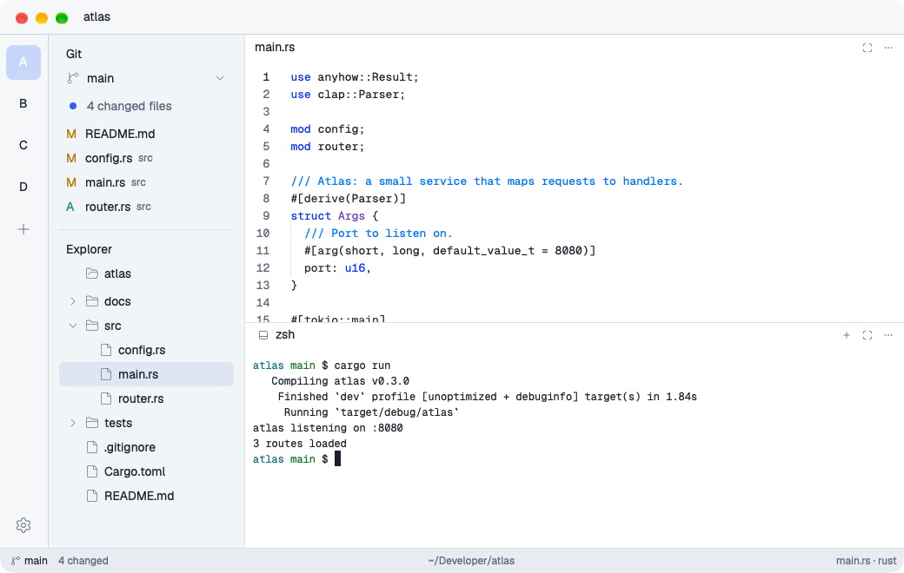

#  Vekro

Vekro brings your projects, a code editor, terminals, and Git together in one native macOS
window. Built with Rust and [GPUI Kit](https://gpui-kit.com).

| Light · Editor | Dark · Git changes |
| --- | --- |
|  |  |

- **Projects** — Create a repository, clone by URL, or import a local folder. Group projects by category, star favorites, and switch between them while their terminals keep running.
- **Editor** — Browse the file tree, edit files in tabs with syntax highlighting, and preview SVG and ICNS images. Press `⌘S` to save.
- **Terminals** — Press `⌘J` to switch between the editor and a full workspace of shells. Open tabs and split panes side by side or vertically.
- **Git** — Review diffs and commit history, commit selected files, compare branches, and fetch, pull, or push from the workspace.
- **Accounts** — Connect GitHub, GitLab, or Azure DevOps to browse repositories and work with pull requests.
- **Appearance** — Choose Light or Dark in Settings, or follow macOS.

## Get started

Vekro supports macOS 15 or later on Apple Silicon. See [GitHub Releases](https://github.com/cagatayldzz/vekro/releases) for downloads, or follow the [development guide](docs/development/index.md) to run it from source.

```sh
bun install
bun run dev
```

## Documentation

- [User guide](docs/guide/index.md) — projects, editor, search, terminals, AI agents, Git, accounts, settings and shortcuts
- [Architecture](docs/architecture/index.md) — crate boundaries, the code map, window layout, data flow and persistence
- [Development](docs/development/index.md) — setup, conventions, testing, performance and releases
- [Project rules](AGENTS.md) — conventions for contributors and AI agents
