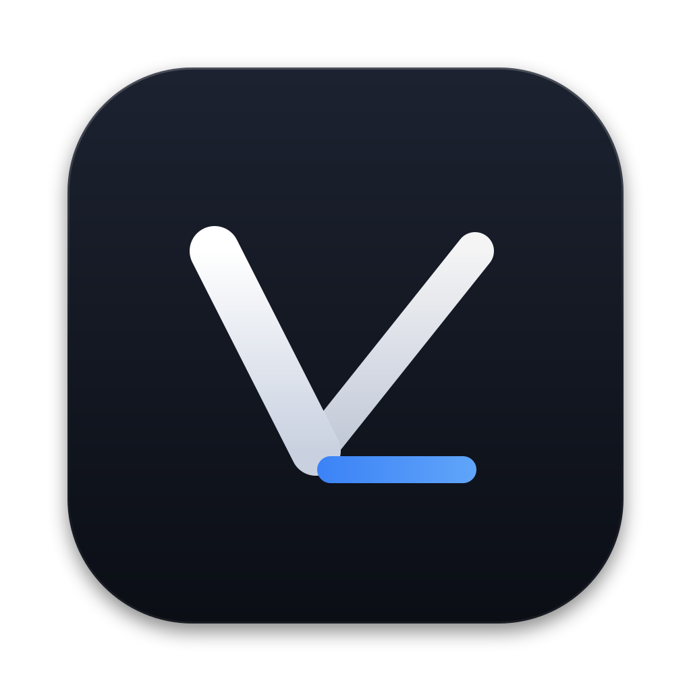
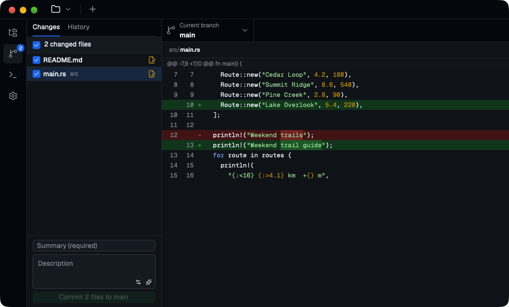
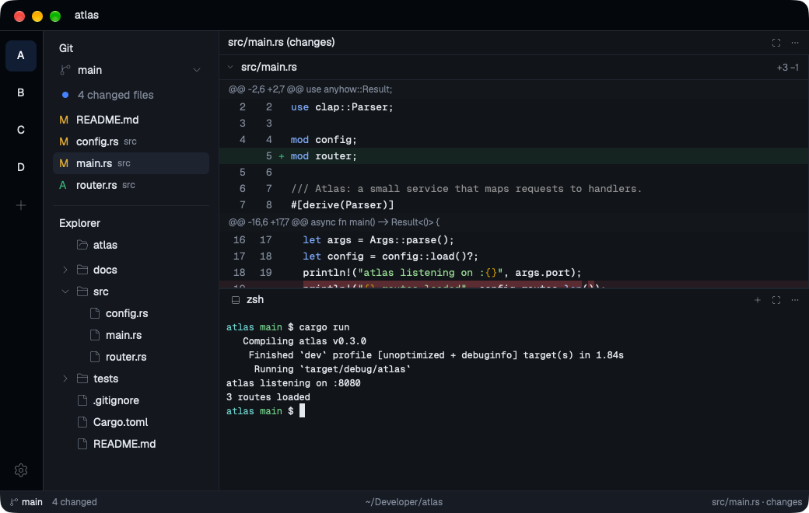
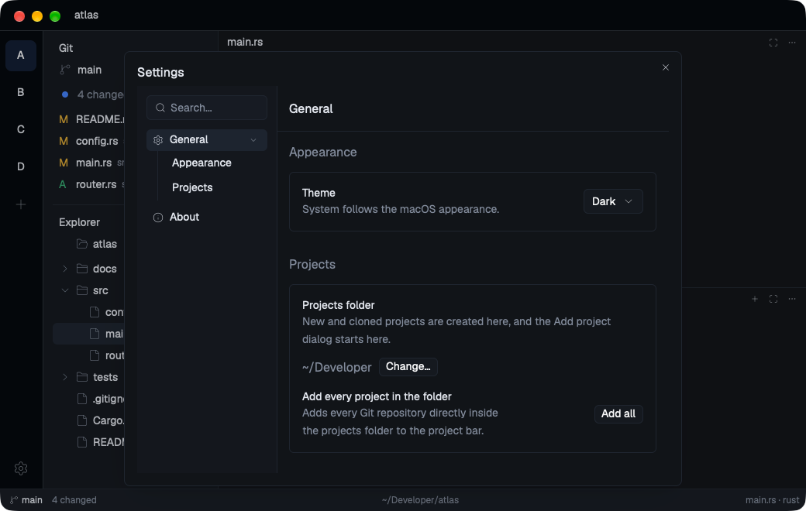

#  Vekro

Projects, a code editor, terminals and Git in one native macOS window, built with Rust and
[GPUI Kit](https://gpui-kit.com).

| Workspace | Changes |
| --- | --- |
|  |  |

| Settings | Light theme |
| --- | --- |
|  |  |

Vekro is not an IDE and not a replacement for any of the three tools it brings together. It
exists so a normal day with a project needs one window: open it, run it, ask an AI assistant
in a second terminal, read or fix some code, look at what changed, commit.

- **Projects:** the title bar names the open project and opens a menu of every project, grouped by category. Switch projects in one
  click; each project keeps its own running terminals.
- **Terminals:** real shells: a panel at the bottom of the window (button in the title bar, `⌘J`). Open several, or split two side by side.
- **Editor:** open files from the folder tree in tabs, with syntax colors and line numbers. `⌘S` saves.
- **Git:** the branch, the list of changed files and the diff of any of them.
- **Light and dark:** follows macOS, or choose one in Settings.

Add a project by creating a new one, cloning a repository by URL, or importing a folder that
already exists on your Mac.

## Get started

Vekro supports macOS 15 or later on Apple Silicon. There are no releases yet; build it locally
with the [development guide](docs/development.md):

```sh
bun install
bun run dev
```

See the [usage guide](docs/usage.md) for shortcuts and what is stored where.

## Documentation

- [Usage](docs/usage.md) — projects, shortcuts, terminals, editor, Git, settings
- [Development](docs/development.md) — platform, commands, packages, tests
- [Architecture](docs/architecture.md) — code map, data flow, persistence
- [Project rules](AGENTS.md) — conventions for contributors and AI agents
